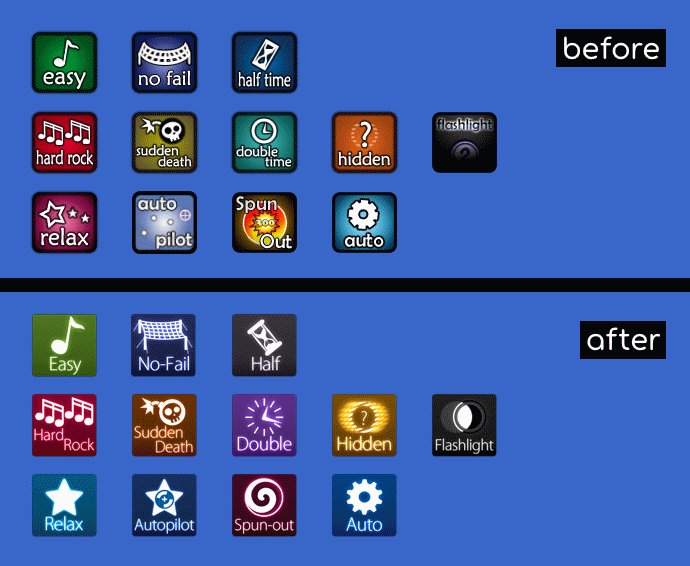
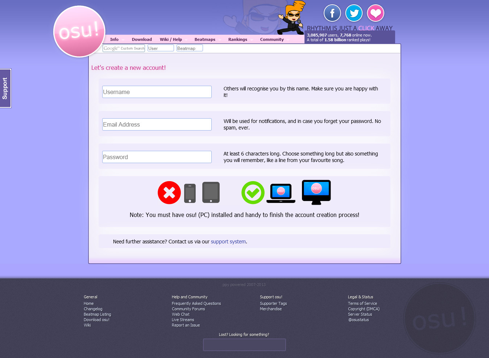
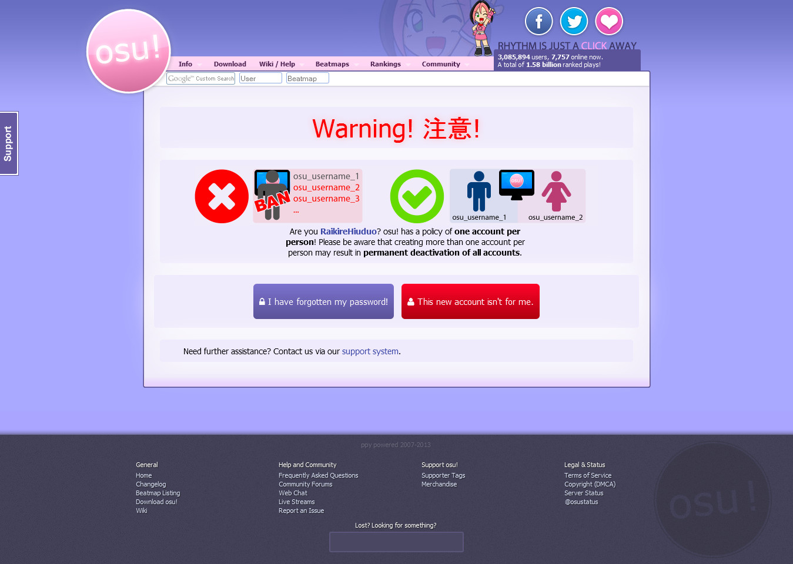
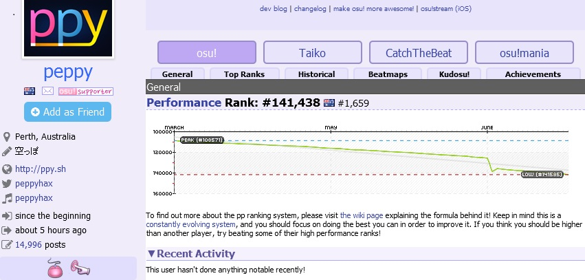
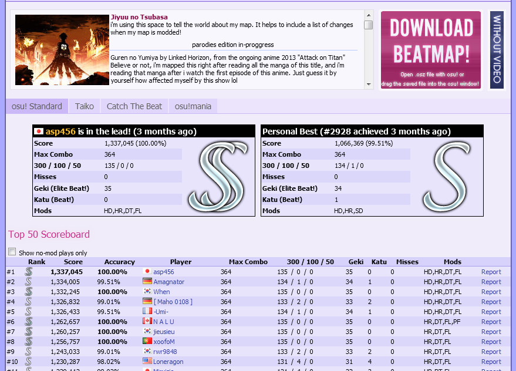
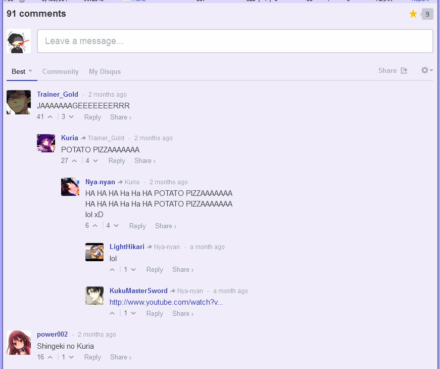
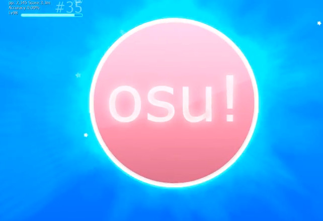
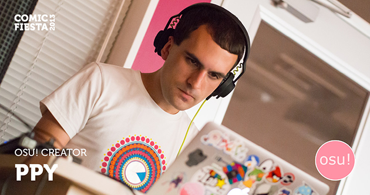

# History of osu! 2013

## January

Widescreen support was added to all [game modes](/wiki/Game_mode), including the [beatmap editor](/wiki/Client/Beatmap_editor). Users became able to reset the key bindings to their defaults. Issues with the hyperdash algorithm in Catch the Beat[^catch] causing [fruits](/wiki/Gameplay/Hit_object/Fruit) to not be catchable in some edge cases were fixed.[^hyperdash-issues] By removing legacy data and checking for optimal table usage, ::{ flag=AU }:: [peppy](https://osu.ppy.sh/users/2) was able to reduce the database's size<!-- how big was the database in total? -->.[^week-in-osu-8] While updating the main menu's copyright graphic to 2013, the copyright text was removed to make the graphic more compact and user-friendly.[^week-in-osu-9]

[Psy - Gangnam style](https://osu.ppy.sh/beatmapsets/55799#osu/169697) mapped by ::{ flag=US }:: [yeahyeahyeahhh](https://osu.ppy.sh/users/58042) was voted to be the most favourite [beatmap](/wiki/Beatmap) of 2012. The top 100 beatmaps are detailed in [this spreadsheet](https://docs.google.com/a/ppy.sh/spreadsheet/ccc?key=0AlsSAL_F7-xDdDRDSjNMN3o3Y1Z6UzA0QUpFNzdlNUE#gid=0).[^best-of-2012]

## February

After the osu! wiki had been tailored to fit the main page design, the old [FAQ](/wiki/FAQ) was superseded by it as a result.[^week-in-osu-10]

::{ flag=CN }:: [woc2006](https://osu.ppy.sh/users/1105845) created an improved version of the [osu!mania](/wiki/Game_mode/osu!mania) editor. A "metadata" bar was added to the [Taiko template background](/wiki/Beatmap/Background/Taiko_template_background) for displaying the song title and the artist below the [playfield](/wiki/Client/Playfield). To hide other metadata in the background, the Taiko[^taiko] playfield was made intransparent. Furthermore, the playfield bar would fade in and out of [kiai time](/wiki/Gameplay/Kiai_time).[^stable-b20130220][^week-in-osu-10]

The in-game chat bot [BanchoBot](/wiki/BanchoBot) received its proper [profile](https://osu.ppy.sh/users/3) and the `!faq` chat command became translatable via [a spreadsheet](https://docs.google.com/a/ppy.sh/spreadsheet/ccc?key=0AlsSAL_F7-xDdHhUUjNSa19QendtcTdYUjE2S2hnVHc#gid=24).[^week-in-osu-11]

A new feature in osu!mania made it possible to flip the playfield vertically which would make gameplay similar to that of DDR/o2jam.[^stable-b20130220][^week-in-osu-12]

Furthermore, the [Hidden](/wiki/Gameplay/Game_modifier/Hidden) and [FadeIn](/wiki/Gameplay/Game_modifier/Fade_In) mods became ranked in osu!mania.[^stable-b20130220]

In addition, [skins](/wiki/Skin) would support double-resolution sprites when the window width was greater than 1600 pixels. To add support to a skin, images with double the width/height required `@2x` as the suffix before the file extension (e.g. `cursor@2x.png`).[^stable-b20130220][^week-in-osu-12]

Lastly, widescreen support was tweaked to allow mappers to place and select objects in the beatmap editor with less limitations, and the online user panels would adjust dynamically to display four columns on all widescreen modes.[^stable-b20130220][^week-in-osu-12]

## March

On March 20, ::{ flag=AU }:: [Ephemeral](https://osu.ppy.sh/users/102335) announced that the osu! staff had been restructured internally to clearly define roles and responsibilities amongst all staff members. The [Language Surveillance Division](/wiki/People/Language_Surveillance_Division) was renamed to "Chat Moderators". The [Support Team](/wiki/People/Technical_Support_Team) was formed as a proper group to help users with technical issues. The "Administrators" group was replaced with the [Global Moderation Team](/wiki/People/Global_Moderation_Team) to solely focus on in-game and forum moderation. For this reason, the BAT map management options became unavailable to GMT members.[^staff-restructure]

<!--
ui revamp and new default skin work in progress (Taiko / CtB / osu!mania still unfinished)
-->

::: Infobox

:::

osu!'s user interface was completely redesigned with the help of ::{ flag=US }:: [RBRat3](https://osu.ppy.sh/users/307202), including the beatmap editor controls, [game modifier](/wiki/Gameplay/Game_modifier) icons and the main menu. Additionally, these changes were made:[^stable-20130319]

- The osu! game mode's leitmotif symbol was tweaked by changing the "osu!" text in the middle of the circle to a "1".
- The special mode selection accessible in the main menu was moved to the [song select](/wiki/Client/Interface#song-select) screen, allowing players to switch game modes quicker and more intuitively.
- [Combo fire](/wiki/Gameplay/Combo_fire) was removed due to performance concerns.
- The result screen would show the beatmap's background image rather than the user skin's result background.
- Hit explosions became visually smaller, improving readability especially on [streams](/wiki/Beatmap/Pattern/osu!/Stream).

To accommodate the major interface overhaul, "osu!default by peppy" was replaced with "osu! by peppy" as the new default skin. Since osu! received support for both widescreen HD and standard resolution, a new setting was added to the `Skins` tab in the options menu. By default, old skin behaviour was used for compatibility and enabling this setting would force the new skin behaviour (e.g. animations) to be in effect instead.

In the [multiplayer](/wiki/Client/Interface/Multiplayer) mode, hosts became able to activate `Free Mods`, allowing players to freely choose any mod combination, except ones that change gameplay speed. The "Game Style" was removed (Host can adjust the Game Style in Song Selection now under "Mods")<!-- I have no idea what "game style" is referring to. -->. The `#userlog` channel was introduced to display the player's recent match result privately.

When hovering over the [performance graph](/wiki/Gameplay/Accuracy#performance-graph) in the [results screen](/wiki/Client/Interface#results-screen), players became able to know how far off their early hits and their late hits were on average. Do note that these values will disappear and can not be saved.<!-- upon exiting the result screen? --> Online leaderboard information in the ranking popup dialog became part of the extended results screen which can be reached by scrolling down in the results screen, or by clicking the button at the bottom of the screen.[^week-in-osu-13]

<!--
still unsure about the paragraph down below. i guess i will have to see if this is okay in the review

What about mentioning auto-scroll? Another feature that people were irritated by was that the scoreboard would automatically scroll {to the personal best?}.

https://osu.ppy.sh/community/forums/topics/124366?n=1
-->

At the end of March, "unified scoreboards" were added which displayed plays with the same mods, scores from friends and local scores in consecutive sections directly below each other in a scrollable list. This feature was only available to [osu!supporters](/wiki/osu!supporter), as peppy wanted to test how the server performance would be affected. The difference between scores was displayed below the accuracy in the respective score panel. After a lot of people criticised the new leaderboard design for being too cluttered and for the inability to scroll to see more top scores from other players, the scoreboard received a second revision just days later. As a result, players became able to choose between the several leaderboards via a dropdown menu. However, the `Global (Selected Mod)`, `Friend` as well as the per-beatmap `Country` ranking added in the same update stayed limited to osu!supporters. Though, the score difference display was kept.[^stable-20130325][^stable-20130328]

Lastly, the player's profile picture had been added beside the [grade](/wiki/Gameplay/Grade) mark in the ranking scoreboard. When hovering over the score, the profile picture would become darker to show the placement number.

## April

Besides publishing patches for the previous major update, the initial support for "collections" enabled users to group beatmaps in as many batches as they wanted, instead of just two like in the "Favourites A/B" feature. This also made it simpler for users to share their favorite beatmaps with others.

The shortcuts `Ctrl` + `1`, `2`, `3` or `4` were added to easily switch in the song select screen to the [osu!](/wiki/Game_mode/osu!), [Taiko](/wiki/Game_mode/osu!taiko), [osu!mania](/wiki/Game_mode/osu!mania) or [Catch the Beat](/wiki/Game_mode/osu!catch) [game mode](/wiki/Game_mode) respectively. osu!mania received the game modifier [Random](/wiki/Gameplay/Game_modifier/Random), which would shuffle the note placement every time a beatmap is played. When using the `Quick Join` button in the multiplayer mode, the room selection was adjusted to take the average pp of all room participants in comparison to the player into consideration<!-- maybe not perfect phrasing? -->.

<!-- Alternative: Comments in beatmap replays imitated the comment style from Niconico, where they would move across the screen in accordance to when they were made. -->

Comments in beatmap [replays](/wiki/Gameplay/Replay) were styled as [danmaku subtitles](https://en.wikipedia.org/wiki/Danmaku_subtitling) where they would move across the screen in accordance to when they were made, similar to the video sharing platform [Niconico](https://en.wikipedia.org/wiki/Niconico). osu!supporters received the ability to set a custom colour for their comments.

All [Mapping Assistance Team](/wiki/People/Mapping_Assistance_Team) (*MAT*) members became [Beatmap Appreciation Team](/People/Beatmap_Appreciation_Team) (*BAT*) members as the MAT was officially dissolved due to responsibilities and permissions being too similar between the two.[^mat-end]

peppy released one of the [initial osu! builds](https://osu.ppy.sh/community/forums/topics/130144) from September 2007, the one he had hoped to release for osu!'s 5th anniversary.

## May

On May 5, the number of users being connected simultaneously exceeded 10,000 for the first time.[^may-june-in-osu]

Game modifiers were shortened to their two-letter acronym (e.g. [Hard Rock](/wiki/Gameplay/Game_modifier/Hard_Rock) became "HR") in the result screen to not clutter the limited space too much. A bug in replays causing misses to be displayed incorrectly was fixed. The spectator system was improved by allowing the user to follow the spectated person if they were spectating someone else. Unless required, the game would no longer force a restart when updating.[^stable-b20130509]

When watching [replays](/wiki/Gameplay/Replay), users received the ability to set the playback speed to 50% by clicking the speed button twice. The playfield would not flash out the background anymore when fully dimmed. [Catch the Beat](/wiki/Game_mode/osu!catch) received joystick support<!-- Taiko too? --> in the song selection menu (`Up`/`Down`: Change song, `Right`: Select, `Left`: Exit).

To address glaring issues in the [forum-based modding](/wiki/Modding/Forum_modding) threads, such as beatmaps becoming [Ranked](/wiki/Beatmap/Category#ranked) even though they were not adhering to the [ranking criteria](/wiki/Ranking_criteria), peppy started working on a new [ranking/modding system](https://osu.ppy.sh/community/forums/topics/129625).

In the multiplayer mode, players became able to use mods from the `Special` category ([Relax](/wiki/Gameplay/Game_modifier/Relax), [Autopilot](/wiki/Gameplay/Game_modifier/Autopilot), [SpunOut](/wiki/Gameplay/Game_modifier/Spun_Out) and [ManiaKeys](/wiki/Gameplay/Game_modifier/xK)) when Free Mod was enabled by the host. Widescreen default sprites (`@2x`) were added to the Taiko game mode. The "Favourites A/B" feature was completely removed in favor of collections.

Three new dedication [achievements](/wiki/Medals) were released for osu!mania that required the player to press 40,000, 400,000, and 4,000,000 keys respectively. Furthermore, the user profile was redesigned, e.g. a user's last visit would be based on when they last signed into the game rather than visits to the web forum.[^may-highlights]

## June

The fourth iteration of the [osu! Beatmapping Contest](https://osu.ppy.sh/community/forums/posts/2324098) had started, where users were required to create 3 difficulties in the osu! game mode to 1 out of 3 songs of their choice. For each song, the winner would receive the "Elite Mapper" title, a $50 Amazon gift card and one year of osu!supporter, whereas the second place would receive three months of osu!supporter.<!-- results? -->[^may-june-in-osu]

To discourage players from creating several accounts for personal reasons, potential consequences for them were made more prominent and clear. Furthermore, an infographic showing that it is not possible to register from mobile devices was added.

Users became able to choose their primary game mode which is shown by default when visiting their profile. Additionally, a new feature allowed users to link their [last.fm](https://last.fm) account on their osu! profile. Moreover, a country performance rank and a pp graph visualising the player performance in the last 90 days<!-- source?--> was added.

If available, the personal best rank would be shown in the leaderboard section on the [beatmap information](/wiki/Beatmap_information) page next to the first place score.[^best-rank-comparison] A Disqus comment feature coupled with [single sign-on](https://en.wikipedia.org/wiki/Single_sign-on) was added to the beatmap information page, allowing for a simple and integrated way of exchanging ideas and opinions about a beatmap.[^may-june-in-osu]

In-game wise, the main menu gets a new visualisation, with a blazing flare around the osu! symbol dependent on intensity of currently playing song's BPM. Performance have been optimised in song selection with many (more than 10,000) maps. Update process robustness and performance have been improved.[^may-june-in-osu]

Gameplay-wise, lead-in time was automatically added to any beatmaps which start abruptly to allow enough time to adjust [Visual Settings](/wiki/Client/Interface/Visual_settings) and total press counts for each key on the input overlay was added. Quick repeat sliders not reaching their maximum combo has been fixed.

Score submission from mania charts was allowed,[^june-highlights] and Top 50 replays was stored rather than the usual Top 40[^may-june-in-osu].

<!--
[poll for changing domain name](https://osu.ppy.sh/community/forums/topics/140667)

100,000 beatmaps submitted[^june-highlights]
-->

## July

[The new regional BATmanagers](https://osu.ppy.sh/community/forums/topics/132667)<!-- announced in May (see footnote) --> began their first major recruitment of new BAT in to the team with the [Summer 2013 NewBAT Applications](https://osu.ppy.sh/community/forums/topics/142864). This provided a chance for the new managers to adequately handle new applications. The new regional managers were [NatsumeRin](https://osu.ppy.sh/users/151679) representing Asia/Oceania, [Kurai](https://osu.ppy.sh/users/77089) representing Europe, and [Garven](https://osu.ppy.sh/users/244216) representing America.[^regional-team]

On 2013-07-02, peppy made the [osu!api](https://osu.ppy.sh/community/forums/topics/141240) open to the public (previously available only through private requests). This allowed independent developers to work on third party services for osu!. On 2013-07-11, the previously broken "forgot password" page has been fixed. 2013-07-18 brought updates to Bancho's fallback connectivity. On 2013-07-21, widescreen support for storyboards was added in the song setup dialog. Two new in-game overlays were added to track accuracy as you play or watch others play. Refer to [Options](/wiki/Client/Options) page for further information.

Links:

- [Summer 2013 NewBAT Applications](https://osu.ppy.sh/community/forums/topics/142864)
- [osu!api open beta](https://osu.ppy.sh/community/forums/topics/141240)

## August

- <https://blog.ppy.sh/post/59476446944/frictionless-updates>
- [Public Release (b20130801)](https://osu.ppy.sh/community/forums/topics/146484?n=1)
- [osu! news](https://osu.ppy.sh/community/forums/topics/147706?n=1)
- [osu!test now more usable](https://osu.ppy.sh/community/forums/topics/147744?n=1)

<!-- October osu!arcade design documents published? -->

## December

[peppy was confirmed for Comic Fiesta 2013 in Malaysia at 21st and 22nd of December in Kuala Lumpur City Center](https://osu.ppy.sh/community/forums/topics/163121). For day 1 (2013-12-21), osu! was shown as a stage event, demonstrating the game in four different game modes (osu!, Taiko, Catch the Beat, and osu!mania). For day 2 (2013-12-22), peppy gives an insight of osu! along with his future update plans at the panel room and showcased osu!tablet for the public to try it out.

One of the current hot topics for debate at the time was that peppy was making a new game mode and was testing it as a proof-in-concept (testing if it's playable, competitive or flexible enough). Some players speculate it was [Touhosu!](https://osu.ppy.sh/community/forums/topics/19307) (dodging the bullet-hell, that was, inverse of [Catch the Beat](/wiki/Game_mode/osu!catch)). By time of writing, not much information was discovered about the new game mode. [A video clip about the talk was in ppy's blog](https://blog.ppy.sh/post/71405880656/i-have-a-few-posts-waiting-for-some-final-touches)

Links:

- [I will be in malaysia (December)](https://osu.ppy.sh/community/forums/topics/163121)
- [Schedule | Comic Fiesta 2013](https://comicfiesta.org/2013/info/event/schedule)
- [New osu! mode announced on CF2013?](https://osu.ppy.sh/community/forums/topics/176000)
- [Comic Fiesta 2013 Impressions & osu! Q&A Panel Session with peppy (ppy) | INFONOCHIKARA 「インフォノチカラ」 Blogotopia](https://infonochikara.wordpress.com/2013/12/30/comic-fiesta-2013-impressions-osu-qa-panel-session-with-peppy-ppy/)
- [osu! panel at Comic Fiesta 2013](https://www.youtube.com/watch?v=IjuaFiLia6w)

## Notes and references

[^catch]: At the time, the [osu!catch](/wiki/Game_mode/osu!catch) [game mode](/wiki/Game_mode) was called Catch the Beat.
[^hyperdash-issues]: [Blog post by ppy (2013-01-07) "Getting Hyperdash Right"](https://blog.ppy.sh/post/39917651337/getting-hyperdash-right)
[^week-in-osu-8]: [Blog post by ppy (2013-01-06) "This Week in osu!"](https://blog.ppy.sh/post/39831318171/this-week-in-osu-8)
[^week-in-osu-9]: [Blog post by ppy (2013-01-20) "This Week in osu!"](https://blog.ppy.sh/post/41003637501/this-week-in-osu-9)
[^best-of-2012]: [Forum thread by peppy (2013-01-09) "Best of 2012 Results"](https://osu.ppy.sh/community/forums/posts/2042263)

[^week-in-osu-10]: [Blog post by peppy (2013-02-13) "This Week in osu!"](https://blog.ppy.sh/post/42178900910/this-week-in-osu-10)
[^week-in-osu-11]: [Blog post by peppy (2013-02-15) "This Week in osu!"](https://blog.ppy.sh/post/43136384020/this-week-in-osu-11)
[^week-in-osu-12]: [Blog post by peppy (2013-02-23) "This Week in osu!"](https://blog.ppy.sh/post/43823357969/this-week-in-osu-12)
[^stable-b20130220]: [Forum thread by peppy (2013-02-20) "osu! release b20130220"](https://osu.ppy.sh/community/forums/posts/2134063)
[^taiko]: At the time, the [osu!taiko](/wiki/Game_mode/osu!taiko) [game mode](/wiki/Game_mode) was called Taiko.

[^stable-20130319]: [Forum thread by peppy (2013-03-19) "osu! Public Release (b20130319)"](https://osu.ppy.sh/community/forums/topics/123276?n=1)
[^stable-20130325]: [Forum thread by peppy (2013-03-25) "osu! Public Release (b20130325)"](https://osu.ppy.sh/community/forums/topics/124366?n=1)
[^stable-20130328]: [Forum thread by peppy (2013-03-28) "osu! Public Release (b20130328)"](https://osu.ppy.sh/community/forums/topics/124848?n=1)
[^week-in-osu-13]: [Blog post by peppy (2013-04-02) "This week (month) in osu!"](https://blog.ppy.sh/post/46924535831/this-week-month-in-osu-13)
[^staff-restructure]: [Forum thread by Ephemeral (2013-03-20) "2013 Staff Restructuring"](https://osu.ppy.sh/community/forums/topics/123510?n=1)

[^mat-end]: [Forum thread by Ephemeral (2023-04-23) "The end of the MAT"](https://osu.ppy.sh/community/forums/topics/129165)

[^stable-b20130509]: [Forum thread by peppy (2013-05-09) "osu! Public Release (b20130509)"](https://osu.ppy.sh/community/forums/topics/131611)
[^may-highlights]: [Forum thread by MillhioreF (2013-05-31) "May 2013 Highlights + Map of the Month"](https://osu.ppy.sh/community/forums/posts/2334705)

[^may-june-in-osu]: [Blog post by peppy (2013-07-03) "The Last Two Months in osu!"](https://blog.ppy.sh/post/54501455726/the-last-two-months-in-osu)
[^june-highlights]: [Forum thread by MillhioreF (2013-07-01) "June 2013 Highlights + Map of the Month"](https://osu.ppy.sh/community/forums/posts/2400775)
[^regional-team]: [Forum thread by Ephemeral (2013-05-15) "Regional Team Management"](https://osu.ppy.sh/community/forums/topics/132667)
[^best-rank-comparison]: [Forum comment by peppy (2013-06-16) in "Can't see my rank in Beatmap Listing Page. [resolved]"](https://osu.ppy.sh/community/forums/topics/137952?n=5)
